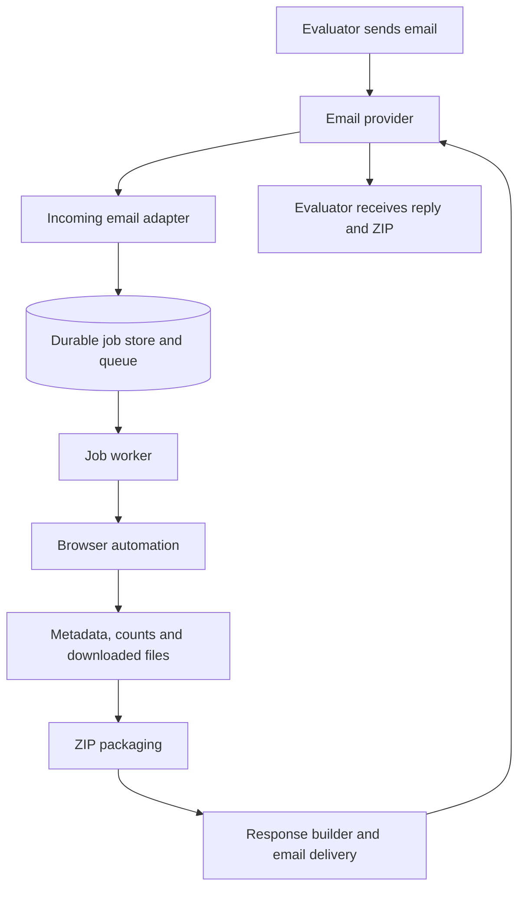

# Senpilot regulatory document agent

Status as of October 24, 2026: the application is running on a DigitalOcean Droplet. A fresh webhook-triggered email request completed with OpenAI parsing, six downloaded PDFs, and a ZIP the recipient confirmed opened. Persistent-volume, restart, backup, and duplicate-delivery checks passed. A stable HTTPS address, whole-host reboot verification, the latest public code, and the demo remain.

## Objective and constraints

Build an email-driven service that accepts a matter number and document type, retrieves up to 10 matching documents from the Nova Scotia public documents website, and replies with a ZIP attachment and factual matter summary.

- Assignment effort is timeboxed to three hours; partial completion is explicitly acceptable.
- Submission is due October 28, 2026 and includes a code link, an email address evaluators can contact, and a shareable Loom video under five minutes.
- Supported categories: Exhibits, Key Documents, Other Documents, Transcripts, Recordings.
- Matter numbers have the form `M` followed by five digits, such as `M12205`.
- The reply must report category counts across the matter, even though downloads come from one requested category.
- The agent handles one or more matters and any number of the supported categories per incoming email. Categories can be shared across matters or selected separately for each matter. It sends one separate result email per distinct matter. An explicit request to send all documents selects all five supported categories. A question asking only for facts or counts receives a summary without files; a bare matter number receives the same summary plus a question about which document types to retrieve.
- The application must remain available for evaluator requests after submission.
- Conversation state, acknowledgments, search indexing, embeddings, a research UI, and document-content analysis are later iterations. OpenAI request parsing is now implemented.

## Architecture

The implemented stack is Python, Playwright with Chromium, signed AgentMail webhook intake (or optional polling), one browser job at a time, and a SQLite-backed queue. DigitalOcean deployment uses separate receiver/worker containers on one Droplet with a shared persistent volume. The Docker build, hosted ten-file scrape, fresh email acceptance, duplicate intake, and service restart checks passed. Development currently uses a temporary HTTPS tunnel; final hosting needs a stable address.

Webhook intake verifies Svix signatures and queues only incoming-message identities for the configured inbox. The worker fetches the canonical message before parsing; this handles webhook bodies omitted by the provider's size limit and lets fetch failures retry durably. Incoming-message uniqueness deduplicates webhook retries and later polling reconciliation. HTML-only emails use visible text extraction. The receiver does no browser or model work.

The email provider handles receiving and sending messages. A separately running application executes the browser workflow. Receiving email alone does not host the agent's retrieval logic.

## Components and boundaries

| Component | Responsibility |
| --- | --- |
| Incoming email adapter | Receive provider events or poll for messages; persist a job before acknowledging the event; deduplicate messages. |
| Request parser | Use OpenAI structured extraction inside a persisted job; locally validate all matter numbers and any number of supported categories, including none. |
| Job store and queue | Persist status, attempts, request details, intermediate results, and delivery information. |
| Browser adapter | Find and verify the matter; extract metadata and all category counts; download up to 10 requested files. |
| Packaging | Use isolated job directories, safe filenames, and ZIP creation; verify the archive contains the expected successful downloads. |
| Response builder | Produce a factual summary and transparent download result from structured data. |
| Email delivery adapter | Reply in the original thread with the ZIP; retain the outgoing provider message ID. |

Incoming messages are persisted before the worker calls OpenAI. Structured extraction returns matter numbers, canonical categories, and ambiguity; local validation confirms every selected matter number occurs in the email. Missing or ambiguous inputs produce clarification. Operational parser failures are classified separately so temporary failures can retry. Browser navigation, counting, downloading, packaging, and response facts follow explicit application logic; a template composes the final email.

Email text, website text, and downloaded documents are data. They cannot override the workflow, select arbitrary retrieval sites, or redirect results to unrelated recipients.

## Email provider decision

**Selected provider: AgentMail.** It provides the agent's inbox, message polling, and threaded replies with ZIP attachments. A real external-sender test has passed.

| Option | Benefits | Constraints relevant to this assignment |
| --- | --- | --- |
| AgentMail | Provider-hosted address avoids custom DNS; supports inbound events and outbound attachments. | Inline API requests have a 6 MB total limit; larger attachments require a URL the provider can download, with approximately 30 MB combined attachment capacity. Recipient limits still apply. |
| Cloudflare Email Workers | Incoming mail can trigger a small Worker and enqueue work. | Requires a domain using Cloudflare DNS. Arbitrary-recipient outbound sending requires Workers Paid and an onboarded sending domain. Ordinary outbound messages have a 5 MiB total limit. |
| Mailgun | Inbound HTTP routes plus outbound API; 25 MB maximum message size. | Custom domain setup is the intended path for evaluator use. The sandbox can only send to authorized recipients. |
| Dedicated Gmail inbox | Existing mailbox can receive requests and send replies without custom DNS. | Requires Google authentication setup; app passwords depend on account eligibility and two-step verification. |

Cloudflare's incoming-event `message.reply()` is tied to that event. The queued job's eventual ZIP response should use an outbound sending API. If Cloudflare is selected for intake, Cloudflare Queues supports an external pull consumer running the browser workflow.

A URL-backed attachment means the email provider fetches the ZIP and attaches it to the email. Merely emailing a download link does not satisfy the assignment's attachment requirement.

## Data to collect and store

Keep browser output structured. A matter lookup produces one metadata snapshot, five category counts, and rows for the documents selected for download. The current SQLite job row stores that result as JSON and keeps file bytes under `runtime/jobs/<job-id>/`. The normalized tables below are a future indexing design, not the current schema.

| Record | Key fields | Why it exists |
| --- | --- | --- |
| `jobs` | `id`, `incoming_message_id`, `request_index`, `parent_job_id`, sender, reply headers, matter number, requested category, status, attempts, `next_attempt_at`, error, ZIP path/size, `outgoing_message_id`, timestamps | The request queue and its progress; prevents duplicate processing. |
| `matter_snapshots` | `job_id`, source URL, matter number, title/description, status, type, category, date received, second date value and observed label, outcome, `scraped_at` | Reproducible facts used in the response. One snapshot per job initially. |
| `category_counts` | `snapshot_id`, category, nullable count, observation status | Exactly five category observations. `NULL` means unavailable; `0` means the site showed none. |
| `documents` | `job_id`, source document ID if visible, title, security label, date filed, extension, displayed position, download status, saved path, byte size, checksum, error | Tracks the selected documents and confirms what went into the ZIP. |

Every nonempty category now exports its Save List PDF. The scraper stores `document_ids_by_category` and `list_pdf_paths` in the result JSON, validates each report against the requested matter/category and tab count, and counts distinct document/exhibit numbers across the complete inventory. Zero-count tabs contribute empty lists. Only the requested categories' Public attachments are downloaded, up to the file and size limits. Report PDFs are retained separately and excluded from the ZIP. A listed document may offer multiple attachments, and records with different numbers may be aliases; these reports establish a document-number count rather than a unique-binary count.

### What the supplied M12205 screenshots and live page show

The matter header is the source for the factual summary. Capture these fields before opening a document tab:

| Website label | Visible value for M12205 | Response treatment |
| --- | --- | --- |
| Matter No | M12205 | Confirm it matches the request. |
| Title - Description | Halifax Regional Water Commission - Windsor Street Exchange Redevelopment Project - $69,275,000 | State the subject and amount as shown. Preserve the full source title. |
| Status | Closed | Report as status; do not infer a closing date. |
| Type | Water | Report as type. |
| Category | Capital Expenditure Approvals on the live page | Report the exact value observed for the requested matter. |
| Date Received | 04/07/2025 | Report as April 7, 2025, labeled **Date received**. |
| Second date | 10/23/2025 | Preserve its observed label: **Decision Date** on the initial header, **Date Final Submission(s)** after opening a document tab. |
| Outcome | Directions given | Report the site's outcome wording; do not interpret it as approval. |

The five tab labels show Exhibits 13, Key Documents 6, Other Documents 43, Transcripts 0, and Recordings 0. Their arithmetic total is **62 listings across these five categories**. The document ID `102674` appeared in both Key Documents and Other Documents, so this is not a unique-file count. Some tab layouts show `Found Count`, but the inspected Key Documents layout did not. Keep the five source counts separately so the total can be recomputed. Live selectors and edge cases are recorded in [UARB_SITE_NOTES.md](./UARB_SITE_NOTES.md).

Example result wording, assuming a request for Other Documents and 10 successful downloads:

> M12205 concerns the Halifax Regional Water Commission's Windsor Street Exchange Redevelopment Project ($69,275,000). The matter is Closed, with Type Water, Category Capital Expenditure Approvals, and Outcome “Directions given.” Date received: April 7, 2025. Decision Date: October 23, 2025. The five categories total 62 document listings: 13 Exhibits, 6 Key Documents, 43 Other Documents, 0 Transcripts, and 0 Recordings. I attached 10 of the 43 Other Documents in a ZIP.

The last sentence must use the actual successful download count. Metadata comes from the header and counts from the tabs; document contents do not need to be summarized. The Exhibits screenshot includes rows labeled Confidential, so retain each row's security label and distinguish unavailable or unsuccessful downloads from the tab's full count.

Keep each scrape tied to a job and timestamp. Later, matter snapshots can be deduplicated into a reusable matter table or expanded into a full searchable document catalog without changing the email request record.

## Job queue and status

Use the `jobs` table as the queue with one worker and a persistent SQLite database. A separate broker is unnecessary for the initial deployment.

`parse_pending → parsing → scraping → downloading → packaging → sending → completed`

Legacy parsed jobs may start at `queued`; ambiguous requests pass through `clarification_pending`. The browser module exposes separate operations for lookup, metadata, category selection, row traversal, and atomic validated downloads. Navigation and transfer retries are bounded, and failed operations retain diagnostic text, screenshots, and page HTML when available.

Use `retry_pending` for a temporary failure and `failed` after retries are exhausted. The current status, stage timestamps, attempts, and last error make progress visible in logs or a small CLI. `completed` means the email provider accepted the result; delivery or a bounce is a separate signal if available.

- Enforce uniqueness on `(inbox_id, message_id, request_index)`. Intake always inserts index 0, so redelivery cannot enqueue the same email twice. Parsing atomically assigns the first matter to that job and queues sibling jobs for the remaining distinct matters with the original message ID and a parent job reference. Each matter has independent retries, ZIP, and delivery idempotency key.
- Claim a job atomically and set a lease deadline; a restarted worker can reclaim an expired job.
- Write progress and scraped facts after each stage. Retain downloaded files and the ZIP so an email retry does not repeat website work.
- Retry temporary website and email failures with a bound; report a permanent failure clearly.
- A send timeout can occur after provider acceptance. Persist exact reply text and the first-send timestamp, reuse the ZIP and AgentMail idempotency key, and hold retries older than 23 hours as `delivery_review`. AgentMail documents a 24-hour idempotency window; held jobs require checking the original thread before manual resolution.
- Failed retrievals retain `failed` status; failure-notification delivery has its own bounded attempts, lease, timestamps, and outgoing message ID.
- Ignore the agent's own outgoing emails and automatic replies.

SQLite requires a persistent volume and a single-host deployment. A host with ephemeral storage needs a hosted database or persistent volume. File paths must also refer to durable storage until the result email is accepted.

## Core response behavior

- A valid request creates one job per distinct matter and receives one result email per matter in the original thread. An immediate acknowledgment is an optional later addition.
- If the matter or category is missing, ambiguous, or unsupported, send a short clarification instead of queuing a scrape.
- Use the website's title, status, type/category, and date fields as labeled; do not invent unavailable facts.
- Report all five category counts and a clearly labeled aggregate. Verify whether categories overlap before calling the aggregate a unique-file total.
- Report the distinct document/exhibit-number total from validated Save List PDFs for every nonempty category, including confidential records. Retry failed or incomplete exports rather than publishing a partial total. Preserve existing reply text when retrying an uncertain delivery.
- Select up to 10 Public files in the site's displayed row order. The site's sorting behavior can change, so record selected IDs in the result.
- Report the available count, the number attached, and any partial failure. For a zero-count category, attach a valid empty ZIP and say that it is empty.
- Keep saved files under a conservative 4 MB total budget before ZIP creation to stay under AgentMail's 6 MB inline request limit after Base64 encoding. Skip an oversized row and continue to later rows; report skips in the reply.

Optional iterations include immediate acknowledgment, using matter context across replies, more flexible language parsing, different document types for different matters in one email, and a status response to “is it ready?” These can use the same job and snapshot records. URL-backed AgentMail attachments could raise the current 4 MB raw-file budget later.

## Hosting and validation gates

Deploy the application to an always-running host with Chromium support, persistent job storage, and temporary file storage. Keep it available during evaluation; laptop sleep would interrupt a laptop-hosted worker.

Validation gates:

1. **Passed locally:** Playwright captured valid PDFs, closed each download dialog, and repeated the flow across multiple rows. See [UARB_SITE_NOTES.md](./UARB_SITE_NOTES.md).
2. **Passed locally:** an independent sender received a threaded reply and opened the ZIP.
3. **Passed locally:** a ten-file Other Documents run stayed within the inline email budget by skipping two large PDFs and selecting later rows.
4. **Passed on host:** files survive container replacement; completed job state and its ZIP survive a service restart. A consistent stopped-state backup was copied off the server. Whole-host reboot recovery remains open.
5. **Passed on host:** a fresh webhook-triggered email completed on the first attempt, its ZIP opened, and signed duplicate intake created no new job or reply. Missing-field and failure cases have automated coverage; corresponding live hosted fault tests remain open.

## Research sources

Provider documentation reviewed October 24, 2026. Limits and pricing should be rechecked when provisioning.

- [AgentMail quickstart](https://docs.agentmail.to/quickstart)
- [AgentMail pricing](https://www.agentmail.to/pricing)
- [AgentMail attachments](https://docs.agentmail.to/attachments)
- [AgentMail webhooks](https://www.agentmail.to/docs/webhooks-overview)
- [AgentMail polling](https://docs.agentmail.to/webhook-polling)
- [AgentMail idempotency](https://www.agentmail.to/docs/knowledge-base/preventing-duplicate-sends)
- [OpenAI structured outputs](https://developers.openai.com/api/docs/guides/structured-outputs?api-mode=responses)
- [Cloudflare email routing setup](https://developers.cloudflare.com/email-service/get-started/route-emails/)
- [Cloudflare email handler API](https://developers.cloudflare.com/email-service/api/route-emails/email-handler/)
- [Cloudflare email limits](https://developers.cloudflare.com/email-service/platform/limits/)
- [Cloudflare email pricing](https://developers.cloudflare.com/email-service/platform/pricing/)
- [Cloudflare Queues external pull consumers](https://developers.cloudflare.com/queues/configuration/pull-consumers/)
- [Mailgun inbound routes](https://documentation.mailgun.com/docs/mailgun/user-manual/receive-forward-store/routes)
- [Mailgun sandbox restrictions](https://documentation.mailgun.com/docs/mailgun/user-manual/domains/domains-sandbox)
- [Mailgun sending limits](https://documentation.mailgun.com/docs/mailgun/user-manual/sending-messages/send-http)
- [Google app password requirements](https://support.google.com/mail/answer/185833?hl=en)
- [Source public documents website](https://uarb.novascotia.ca/fmi/webd/UARB15)
