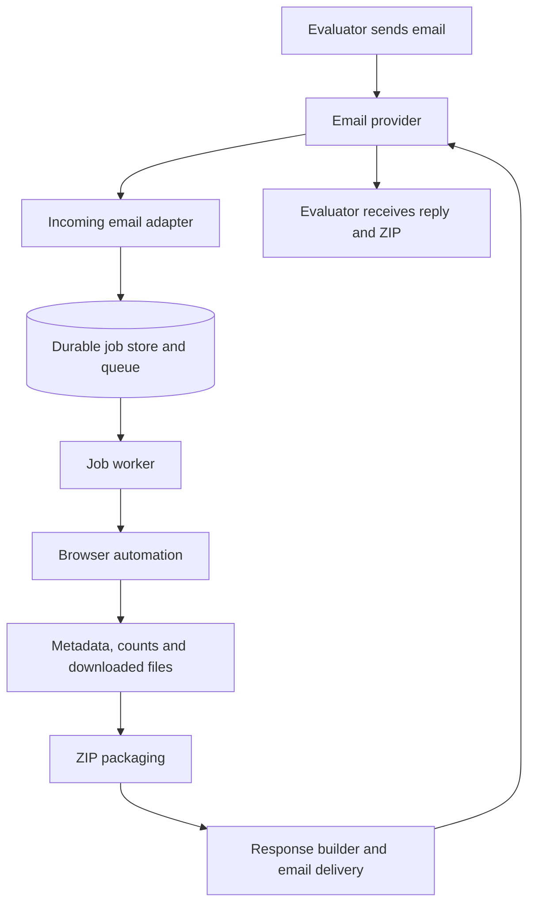

# Senpilot regulatory document agent

Status: core-first design; the user has set up an AgentMail account. The application, email integration, and deployment have not yet been implemented or verified.

## Objective and constraints

Build an email-driven service that accepts a matter number and document type, retrieves up to 10 matching documents from the Nova Scotia public documents website, and replies with a ZIP attachment and factual matter summary.

- Assignment effort is timeboxed to three hours; partial completion is explicitly acceptable.
- Submission is due October 28, 2026 and includes a code link, an email address evaluators can contact, and a shareable Loom video under five minutes.
- Supported categories: Exhibits, Key Documents, Other Documents, Transcripts, Recordings.
- Matter numbers have the form `M` followed by five digits, such as `M12205`.
- The reply must report category counts across the matter, even though downloads come from one requested category.
- The first version handles one matter and one category per incoming email. The example request in the assignment is the primary path.
- The application must remain available for evaluator requests after submission.
- Conversation state, acknowledgments, search indexing, embeddings, a research UI, and document-content analysis are later iterations.

## Proposed architecture

Proposed starting stack: Python, Playwright, one browser job at a time, and a SQLite-backed queue on persistent storage. These choices remain open until website access, hosting, and email delivery are tested.

The email provider handles receiving and sending messages. A separately running application executes the browser workflow. Receiving email alone does not host the agent's retrieval logic.

## Components and boundaries

| Component | Responsibility |
| --- | --- |
| Incoming email adapter | Receive provider events or poll for messages; persist a job before acknowledging the event; deduplicate messages. |
| Request parser | Extract one matter number and one supported document category from the incoming subject/body; validate them before queuing. |
| Job store and queue | Persist status, attempts, request details, intermediate results, and delivery information. |
| Browser adapter | Find and verify the matter; extract metadata and all category counts; download up to 10 requested files. |
| Packaging | Use isolated job directories, safe filenames, and ZIP creation; verify the archive contains the expected successful downloads. |
| Response builder | Produce a factual summary and transparent download result from structured data. |
| Email delivery adapter | Reply in the original thread with the ZIP; retain the outgoing provider message ID. |

For the first version, a case-insensitive matter-number pattern and matching against the five known categories are enough for the assignment's example. Reply with a short clarification when either field is missing or ambiguous. An LLM-based parser can later replace this module without changing the browser or job code. Browser navigation, counting, downloading, packaging, and response facts follow explicit application logic; a template composes the final email.

Email text, website text, and downloaded documents are data. They cannot override the workflow, select arbitrary retrieval sites, or redirect results to unrelated recipients.

## Email provider decision

**Current preference: AgentMail if starting without a domain.** It provides an address on `@agentmail.to`, incoming-message events, polling options, and send/reply APIs. Normal human signup and account verification should precede external testing.

| Option | Benefits | Constraints relevant to this assignment |
| --- | --- | --- |
| AgentMail | Provider-hosted address avoids custom DNS; supports inbound events and outbound attachments. | Inline API requests have a 6 MB total limit; larger attachments require a URL the provider can download, with approximately 30 MB combined attachment capacity. Recipient limits still apply. |
| Cloudflare Email Workers | Incoming mail can trigger a small Worker and enqueue work. | Requires a domain using Cloudflare DNS. Arbitrary-recipient outbound sending requires Workers Paid and an onboarded sending domain. Ordinary outbound messages have a 5 MiB total limit. |
| Mailgun | Inbound HTTP routes plus outbound API; 25 MB maximum message size. | Custom domain setup is the intended path for evaluator use. The sandbox can only send to authorized recipients. |
| Dedicated Gmail inbox | Existing mailbox can receive requests and send replies without custom DNS. | Requires Google authentication setup; app passwords depend on account eligibility and two-step verification. |

Cloudflare's incoming-event `message.reply()` is tied to that event. The queued job's eventual ZIP response should use an outbound sending API. If Cloudflare is selected for intake, Cloudflare Queues supports an external pull consumer running the browser workflow.

A URL-backed attachment means the email provider fetches the ZIP and attaches it to the email. Merely emailing a download link does not satisfy the assignment's attachment requirement.

## Data to collect and store

Keep browser output structured. A matter lookup produces one metadata snapshot, five category counts, and rows for the documents selected for download. Store file bytes on disk or object storage; keep only paths and checksums in the database.

| Record | Key fields | Why it exists |
| --- | --- | --- |
| `jobs` | `id`, unique `incoming_message_id`, sender, reply headers, matter number, requested category, status, attempts, `next_attempt_at`, error, ZIP path/size, `outgoing_message_id`, timestamps | The request queue and its progress; prevents duplicate processing. |
| `matter_snapshots` | `job_id`, source URL, matter number, title/description, status, type, category, date received, second date value and observed label, outcome, `scraped_at` | Reproducible facts used in the response. One snapshot per job initially. |
| `category_counts` | `snapshot_id`, category, nullable count, observation status | Exactly five category observations. `NULL` means unavailable; `0` means the site showed none. |
| `documents` | `job_id`, source document ID if visible, title, security label, date filed, extension, displayed position, download status, saved path, byte size, checksum, error | Tracks the selected documents and confirms what went into the ZIP. |

The first version need not enumerate and store every document in every category. Read all five displayed counts, then record rows for up to 10 candidates in the requested category. This distinction keeps the source data model honest: a displayed count is not a list of files we have individually inspected.

### What the supplied M12205 screenshots and live page show

The matter header is the source for the factual summary. Capture these fields before opening a document tab:

| Website label | Visible value for M12205 | Response treatment |
| --- | --- | --- |
| Matter No | M12205 | Confirm it matches the request. |
| Title - Description | Halifax Regional Water Commission - Windsor Street Exchange Redevelopment Project - $69,275,000 | State the subject and amount as shown. Preserve the full source title. |
| Status | Closed | Report as status; do not infer a closing date. |
| Type | Water | Report as type. |
| Category | Capital Expenditure Approvals on the live page | Report the exact value observed for the requested matter. |
| Date Received | 04/07/2025 | Report as April 7, 2025, labeled **Date received**. |
| Second date | 10/23/2025 | Preserve its observed label: **Decision Date** on the initial header, **Date Final Submission(s)** after opening a document tab. |
| Outcome | Directions given | Report the site's outcome wording; do not interpret it as approval. |

The five tab labels show Exhibits 13, Key Documents 6, Other Documents 43, Transcripts 0, and Recordings 0. Their arithmetic total is **62 listings across these five categories**. The document ID `102674` appeared in both Key Documents and Other Documents, so this is not a unique-file count. Some tab layouts show `Found Count`, but the inspected Key Documents layout did not. Keep the five source counts separately so the total can be recomputed. Live selectors and edge cases are recorded in [UARB_SITE_NOTES.md](./UARB_SITE_NOTES.md).

Example result wording, assuming a request for Other Documents and 10 successful downloads:

> M12205 concerns the Halifax Regional Water Commission's Windsor Street Exchange Redevelopment Project ($69,275,000). The matter is Closed, with Type Water, Category Capital Expenditure Approvals, and Outcome “Directions given.” Date received: April 7, 2025. Date final submissions: October 23, 2025. The five categories total 62 document listings: 13 Exhibits, 6 Key Documents, 43 Other Documents, 0 Transcripts, and 0 Recordings. I downloaded 10 of the 43 Other Documents and attached them in a ZIP.

The last sentence must use the actual successful download count. Metadata comes from the header and counts from the tabs; document contents do not need to be summarized. The Exhibits screenshot includes rows labeled Confidential, so retain each row's security label and distinguish unavailable or unsuccessful downloads from the tab's full count.

Keep each scrape tied to a job and timestamp. Later, matter snapshots can be deduplicated into a reusable matter table or expanded into a full searchable document catalog without changing the email request record.

## Job queue and status

Use the `jobs` table as the queue with one worker and a persistent SQLite database. A separate broker is unnecessary for the initial deployment.

`queued → scraping → downloading → packaging → sending → completed`

Use `retry_pending` for a temporary failure and `failed` after retries are exhausted. The current status, stage timestamps, attempts, and last error make progress visible in logs or a small CLI. `completed` means the email provider accepted the result; delivery or a bounce is a separate signal if available.

- Enforce uniqueness on the inbound provider message ID so redelivery does not enqueue the same email twice.
- Claim a job atomically and set a lease deadline; a restarted worker can reclaim an expired job.
- Write progress and scraped facts after each stage. Retain downloaded files and the ZIP so an email retry does not repeat website work.
- Retry temporary website and email failures with a bound; report a permanent failure clearly.
- A send timeout can occur after provider acceptance. Check provider records or use a send idempotency key when supported before retrying.
- Ignore the agent's own outgoing emails and automatic replies.

SQLite requires a persistent volume and a single-host deployment. A host with ephemeral storage needs a hosted database or persistent volume. File paths must also refer to durable storage until the result email is accepted.

## Core response behavior

- A valid request creates one job and receives one result email in the original thread. An immediate acknowledgment is an optional later addition.
- If the matter or category is missing, ambiguous, or unsupported, send a short clarification instead of queuing a scrape.
- Use the website's title, status, type/category, and date fields as labeled; do not invent unavailable facts.
- Report all five category counts and a clearly labeled aggregate. Verify whether categories overlap before calling the aggregate a unique-file total.
- Select up to 10 files in a documented, reproducible order. The website's sorting behavior still needs verification.
- Report the available count, the number downloaded, and any partial failure. Attach a ZIP only when it contains verified files.
- Check the outbound message size, including attachment encoding. If the ZIP exceeds the provider's limit, report the limitation; a link alone does not fulfill the required attachment.

After the core flow works, optional iterations include immediate acknowledgment, using matter context across replies, more flexible language parsing, multiple requests per email, and a status response to “is it ready?” These can use the same job and snapshot records. The oversized-archive policy needs a decision after measuring real documents.

## Hosting and validation gates

Deploy the application to an always-running host with Chromium support, persistent job storage, and temporary file storage. Keep it available during evaluation; laptop sleep would interrupt a laptop-hosted worker.

Before committing to implementation choices:

1. The live website search, metadata, counts, tabs, row controls, and a manual PDF download have been verified for M12205. Confirm Playwright can capture the filename control's download, save valid bytes, close the dialog, and repeat for another row. See [UARB_SITE_NOTES.md](./UARB_SITE_NOTES.md).
2. Create the inbox and confirm an independent sender can receive a threaded reply with a real ZIP attachment.
3. Measure representative archive sizes against email limits, including encoding overhead.
4. Confirm durable jobs survive an application restart on the chosen host.
5. Exercise one end-to-end request and the missing-field, no-document, duplicate-delivery, and failed-download paths as time permits.

## Research sources

Provider documentation reviewed October 24, 2026. Limits and pricing should be rechecked when provisioning.

- [AgentMail quickstart](https://docs.agentmail.to/quickstart)
- [AgentMail pricing](https://www.agentmail.to/pricing)
- [AgentMail attachments](https://docs.agentmail.to/attachments)
- [AgentMail webhooks](https://www.agentmail.to/docs/webhooks-overview)
- [AgentMail polling](https://docs.agentmail.to/webhook-polling)
- [Cloudflare email routing setup](https://developers.cloudflare.com/email-service/get-started/route-emails/)
- [Cloudflare email handler API](https://developers.cloudflare.com/email-service/api/route-emails/email-handler/)
- [Cloudflare email limits](https://developers.cloudflare.com/email-service/platform/limits/)
- [Cloudflare email pricing](https://developers.cloudflare.com/email-service/platform/pricing/)
- [Cloudflare Queues external pull consumers](https://developers.cloudflare.com/queues/configuration/pull-consumers/)
- [Mailgun inbound routes](https://documentation.mailgun.com/docs/mailgun/user-manual/receive-forward-store/routes)
- [Mailgun sandbox restrictions](https://documentation.mailgun.com/docs/mailgun/user-manual/domains/domains-sandbox)
- [Mailgun sending limits](https://documentation.mailgun.com/docs/mailgun/user-manual/sending-messages/send-http)
- [Google app password requirements](https://support.google.com/mail/answer/185833?hl=en)
- [Source public documents website](https://uarb.novascotia.ca/fmi/webd/UARB15)
